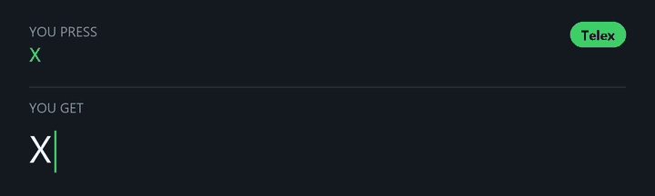
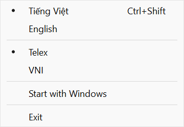

<p align="center">
  
</p>

<h1 align="center">minikey</h1>

<p align="center">
  A tiny Vietnamese input method for Windows.<br>
  Telex and VNI, a tray icon, and nothing else.
</p>

<p align="center">
  <a href="https://github.com/NooberCong/minikey/releases/latest/download/minikey.exe"><b>Download minikey.exe</b></a>
  &nbsp;·&nbsp; Windows 11, 64-bit &nbsp;·&nbsp; 278 KB
</p>

<p align="center">
  
</p>

## Why minikey

minikey is a stripped-down [VnKey](https://github.com/marixdev/vnkey). It keeps the typing engine and drops everything else.

- **Tiny:** one 278 KB file, with no installer and no runtime to install.
- **Light:** about 0.3 MB of memory when idle, and no CPU use while you move the mouse.
- **Works where you type:** tested in Chrome, Edge, Word, Windows Terminal, PowerShell and cmd.

## Get started

1. Download [`minikey.exe`](https://github.com/NooberCong/minikey/releases/latest/download/minikey.exe) and put it somewhere permanent, such as `%LOCALAPPDATA%\Programs\minikey`.
2. Double-click it. The build is unsigned, so Windows may warn you the first time: choose **More info**, then **Run anyway**.
3. Find the green **V** in the system tray. If it is hidden under the **^** arrow, drag it onto the taskbar.
4. Right-click the icon and turn on **Start with Windows**.

Start typing. minikey begins in Vietnamese with Telex.

## Using it

| Icon | Mode |
| :---: | --- |
| 🟩 **V** | Vietnamese |
| 🟦 **E** | English: keys pass straight through |



- **Switch language:** press <kbd>Ctrl</kbd>+<kbd>Shift</kbd>, or left-click the icon.
- **Switch Telex/VNI:** right-click the icon.
- **Exit:** right-click the icon.

Your choices are saved as soon as you make them and survive restarts.

<br clear="right">

## Typing guide

| Result | Telex | VNI |
| --- | --- | --- |
| â ê ô | `aa` `ee` `oo` | `a6` `e6` `o6` |
| ă | `aw` | `a8` |
| ơ ư | `ow` `uw` | `o7` `u7` |
| đ | `dd` | `d9` |
| á (sắc) | `as` | `a1` |
| à (huyền) | `af` | `a2` |
| ả (hỏi) | `ar` | `a3` |
| ã (ngã) | `ax` | `a4` |
| ạ (nặng) | `aj` | `a5` |
| Remove the tone | `z` | `0` |

Whole words work the same way: `dduwowngf` or `d9u7o7ng2` gives **đường**.

- **Undo a mark:** press its key again. `ass` gives `as`, and `a11` gives `a1`.
- **Telex shortcuts:** `w` alone gives `ư`, `[` gives `ơ`, and `]` gives `ư`.
- **English words:** words that can't be Vietnamese are left alone, so `windows` and `google` stay as typed.
- **Tone placement:** minikey uses the modern style, as in `hoà` and `thuý`.

## Good to know

- **Admin windows:** minikey runs without admin rights, so Windows won't let it type Vietnamese into apps running as administrator.
- **Remote desktops and VMs:** keys pass through untouched. Use an input method inside the remote machine.
- **Moving the file:** **Start with Windows** remembers the exact path. After moving `minikey.exe`, turn the option off and on again.
- **Not tested yet:** Firefox, Excel, PowerPoint and Windows 10.

**To uninstall,** turn off **Start with Windows**, choose **Exit**, and delete `minikey.exe`. To clear your settings too, delete the registry key `HKCU\Software\minikey`.

## How it compares

Measured on one Windows 11 machine, with VnKey's settings window open.

| | minikey | VnKey |
| --- | ---: | ---: |
| Processes | 1 | 7 |
| Memory, main process | 0.3 MB | 23.6 MB |
| Memory, all processes | 0.3 MB | 344 MB |

Memory is working set. minikey can briefly reach about 2 MB while you type, then trims itself back within a minute.

## Building from source

You need [Rust](https://rustup.rs) and the MSVC build tools.

```sh
rustup target add x86_64-pc-windows-msvc
cargo build --release
```

The result is `target/x86_64-pc-windows-msvc/release/minikey.exe`. If your Rust host toolchain is the GNU one, `windres` must also be on your `PATH`; MSYS2 provides it.

## Testing

| Command | What it checks |
| --- | --- |
| `cargo test` | Typing rules, about 53,000 valid syllables, and fuzzing |
| `cargo run --release` in `tools/difftest` | The engine against upstream VnKey, on random key sequences |
| `python tools/e2e.py <exe> [groups]` | Real apps, on a private desktop |

The final engine matched VnKey on more than 22 million random sequences.

`e2e.py` takes over the screen while it runs, and it stops any running minikey and deletes its settings. Exit minikey and note your settings first.

## Project layout

| Path | Contents |
| --- | --- |
| `src/engine/` | The typing engine: `no_std`, no allocation, no `unsafe` |
| `src/hook.rs` | Keyboard and mouse hooks |
| `src/inject.rs` | Writes text into the focused app, and picks how for each app |
| `src/tray.rs` | Tray icon and menu |
| `src/settings.rs` | Settings and startup, in the registry |
| `tools/` | Test harnesses and the icon and demo generators |

## License

[GPL-3.0-or-later](LICENSE). minikey is derived from [VnKey](https://github.com/marixdev/vnkey) by marixdev, under the same license.
